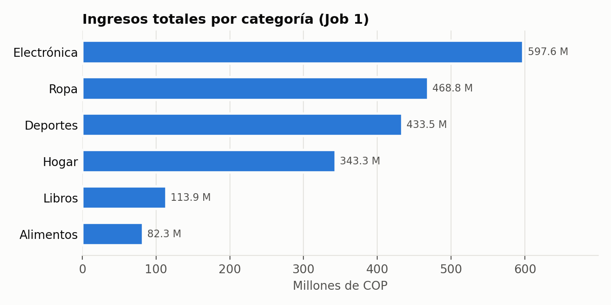
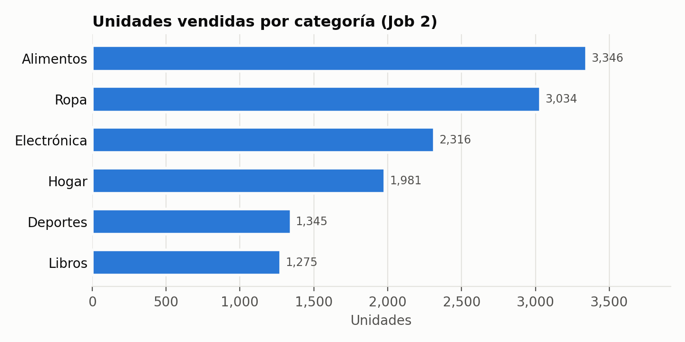
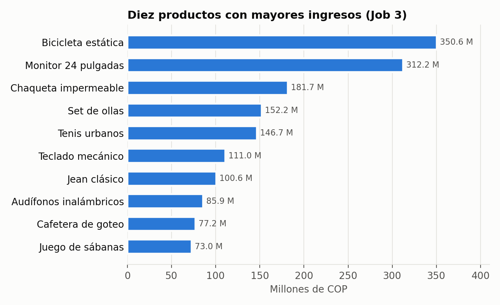
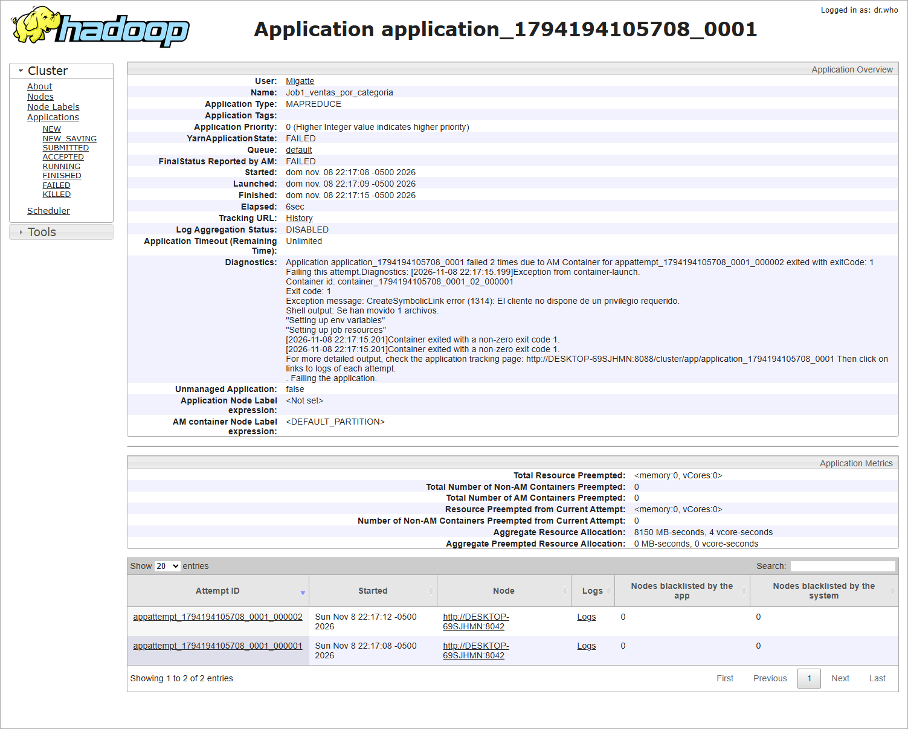
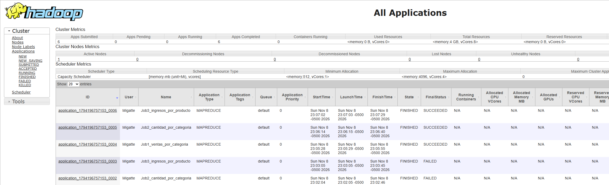
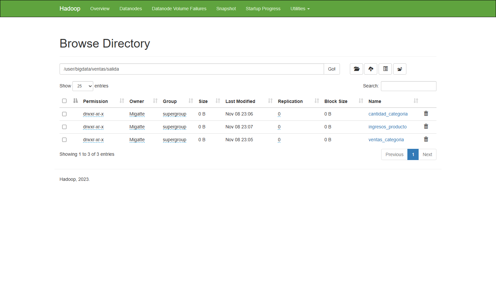

<div class="portada" markdown="1">

<p class="titulo-apa">Informe Técnico – Análisis de Big Data con MapReduce</p>
<p class="titulo-apa">Práctica R2-A4-S15: Procesamiento de un Dataset de Ventas con Apache Hadoop y Hadoop Streaming</p>

<br>

Nikolas Esteban Krejci

Especialización en Analítica y Ciencia de Datos, Universidad de Cundinamarca

Big Data

8 de noviembre de 2026

</div>

<div class="salto"></div>

## Resumen

<div class="resumen" markdown="1">
Este informe documenta una práctica de procesamiento de datos con el paradigma MapReduce sobre Apache Hadoop 3.3.6. Se instaló Hadoop en un equipo con Windows 11 y Java 17, se configuró HDFS en modo pseudodistribuido y se cargó en él un dataset sintético de 5 000 ventas generado de forma reproducible. Tres procesos escritos en Python y ejecutados con Hadoop Streaming calcularon los ingresos por categoría, las unidades vendidas por categoría y los ingresos por producto. Los Mappers validan cada registro: omiten el encabezado, descartan valores nulos o no numéricos, normalizan la coma decimal y recalculan importes ausentes. De los 5 001 registros leídos, 4 878 resultaron válidos. Los ingresos totales sumaron 2 039 478 700 COP, con Electrónica como la categoría de mayores ingresos (29,3 %) y Alimentos como la de mayor volumen de unidades (25,2 %) pero la de menores ingresos (4,0 %). Los jobs se ejecutaron primero en modo local y después en contenedores YARN, con los servicios iniciados desde una terminal de administrador. En YARN, cada job usó dos tareas map en paralelo y una tarea reduce. Las dos ejecuciones dieron los mismos resultados, y un cálculo independiente con pandas reprodujo exactamente las 36 cifras. Todos los servicios funcionaron en un solo equipo, de modo que no hubo procesamiento distribuido entre varias máquinas.

*Palabras clave:* Big Data, Apache Hadoop, MapReduce, HDFS, Hadoop Streaming, análisis de ventas.

</div>

<div class="salto"></div>

## Informe Técnico – Análisis de Big Data con MapReduce

Cuando el volumen de datos supera lo que un solo equipo puede almacenar o procesar en un tiempo razonable, el cómputo se reparte entre varias máquinas. MapReduce, propuesto por Dean y Ghemawat (2008), reduce ese reparto a dos funciones que escribe el programador, *map* y *reduce*. El marco de ejecución se encarga de particionar la entrada, programar las tareas, agrupar los datos intermedios y recuperarse de fallos. Apache Hadoop implementa este modelo junto con un sistema de archivos distribuido, HDFS (Shvachko et al., 2010), y un gestor de recursos, YARN (Vavilapalli et al., 2013).

El objetivo de esta práctica es aplicar ese modelo a un caso concreto: agregar las ventas de un comercio por categoría y por producto. El informe describe el entorno realmente configurado, el diseño de los Mappers y Reducers, los comandos ejecutados, los resultados obtenidos y su interpretación. También expone las limitaciones del entorno, en particular la diferencia entre lo que se ejecutó (Hadoop con HDFS y YARN en un solo equipo) y un clúster de varios nodos, que no se utilizó.

## Objetivos

### Objetivo general

Implementar y ejecutar procesos MapReduce sobre Apache Hadoop para analizar un dataset de ventas en formato CSV, y documentar el procedimiento y los resultados de manera reproducible.

### Objetivos específicos

1. Instalar y configurar Hadoop 3.3.6 con HDFS en el equipo de trabajo y verificar su funcionamiento.
2. Diseñar tres pares Mapper/Reducer en Python que calculen ingresos por categoría, unidades por categoría e ingresos por producto, con manejo de datos defectuosos.
3. Ejecutar los procesos con Hadoop Streaming usando HDFS como almacenamiento de entrada y salida, y conservar los registros de ejecución.
4. Verificar la exactitud de los resultados con un cálculo independiente.
5. Analizar e interpretar los resultados e identificar las limitaciones del procesamiento realizado.

## Marco teórico

### Big Data

Gandomi y Haider (2015) caracterizan Big Data por el **volumen** de los datos, su **variedad** (estructurados, semiestructurados y no estructurados) y la **velocidad** con que se generan y deben analizarse. A estas dimensiones suelen sumarse otras, como la veracidad y el valor. Los autores destacan que la dificultad no está solo en almacenar los datos: también hay que extraer conocimiento de ellos con métodos que escalen. Esa necesidad de escalar horizontalmente es la que motivó modelos de programación como MapReduce.

### Apache Hadoop

Apache Hadoop es un marco de código abierto para el almacenamiento y el procesamiento distribuido de grandes conjuntos de datos en clústeres de equipos convencionales. En la versión 3.x tiene tres componentes principales: HDFS para el almacenamiento, YARN para la gestión de recursos y la planificación, y MapReduce como modelo de programación que se ejecuta sobre YARN (Apache Software Foundation [ASF], 2023a). Hadoop puede funcionar en modo local, en modo pseudodistribuido (todos los servicios en un solo equipo) o en modo totalmente distribuido (ASF, 2023b).

### Arquitectura de HDFS

HDFS tiene una arquitectura maestro-esclavo. Un **NameNode** gestiona el espacio de nombres del sistema de archivos y la correspondencia entre archivos y bloques. Los **DataNodes** almacenan los bloques y atienden las lecturas y escrituras de los clientes. Cada archivo se divide en bloques, 128 MB por defecto, y cada bloque se replica en varios DataNodes para tolerar fallos (ASF, 2023d; Shvachko et al., 2010). HDFS está pensado para archivos grandes, acceso secuencial y un patrón de escribir una vez y leer muchas. Además, permite llevar el cómputo hacia los nodos donde residen los datos en lugar de mover los datos.

### Paradigma MapReduce

En MapReduce, el usuario define una función *map*, que transforma cada registro de entrada en cero o más pares clave-valor intermedios, y una función *reduce*, que recibe una clave junto con todos sus valores y produce el resultado agregado (Dean y Ghemawat, 2008). Entre ambas fases, el marco realiza el **shuffle and sort**: ordena la salida de los Mappers y la agrupa por clave antes de entregarla a los Reducers (ASF, 2023e). Un trabajo (*job*) divide la entrada en fragmentos independientes (*input splits*), que las tareas map procesan en paralelo.

### Componentes Mapper, Combiner y Reducer

El **Mapper** procesa un split registro a registro. En Hadoop, el **Combiner** es una agregación local opcional que se aplica a la salida de cada Mapper antes de enviarla por la red. Si la operación es asociativa y conmutativa, como la suma, el mismo código del Reducer puede usarse como Combiner (ASF, 2023e). El **Reducer** recibe las claves ordenadas y emite el resultado final, que se escribe en el sistema de archivos como archivos `part-NNNNN`.

**Hadoop Streaming** permite usar cualquier ejecutable como Mapper o Reducer: el programa lee líneas por la entrada estándar y escribe líneas por la salida estándar. Por defecto, la clave es el texto hasta el primer tabulador y el resto es el valor. Un proceso de Streaming también puede actualizar contadores de Hadoop escribiendo en la salida de error líneas con la forma `reporter:counter:<grupo>,<contador>,<incremento>` (ASF, 2023c).

### Procesamiento distribuido y YARN

YARN separa la gestión de recursos del modelo de programación. Un **ResourceManager** global asigna recursos y un **NodeManager** en cada nodo lanza y supervisa contenedores. Cada aplicación tiene un **ApplicationMaster** que negocia contenedores y coordina sus tareas (ASF, 2023a; Vavilapalli et al., 2013). El paralelismo y la tolerancia a fallos de MapReduce dependen de que las tareas puedan ejecutarse en contenedores repartidos entre varios nodos y reintentarse cuando alguno falla (Dean y Ghemawat, 2008).

## Metodología

El trabajo se hizo en este orden:

1. **Inspección del entorno.** Se comprobaron Java, Python, Git, Hadoop, WSL y Docker, y se buscaron datasets y proyectos previos.
2. **Preparación de datos.** Al no encontrar un dataset de ventas previo, y con autorización del estudiante, se generó uno sintético y reproducible.
3. **Instalación y configuración de Hadoop.** Se usó el binario oficial verificado por SHA-512 y se configuró en modo pseudodistribuido.
4. **Implementación** de tres pares Mapper/Reducer en Python, con un módulo común de validación.
5. **Prueba previa local.** Se ejecutó la tubería `cat | mapper | sort | reducer` para depurar los scripts. Esta prueba no forma parte de los resultados.
6. **Ejecución con Hadoop Streaming** sobre HDFS, primero en modo local y después en contenedores YARN, conservando logs y contadores.
7. **Verificación independiente** de los resultados con pandas.
8. **Análisis** de los resultados y elaboración de gráficos a partir de las salidas de Hadoop.

## Entorno de desarrollo y configuración

<p class="tabla-num">Tabla 1</p>
<p class="tabla-tit">Entorno de ejecución verificado</p>

| Componente | Versión / valor |
|---|---|
| Sistema operativo | Windows 11 Pro 10.0.26200, equipo DESKTOP-69SJHMN |
| Java | OpenJDK 17.0.19 (Microsoft Build) |
| Apache Hadoop | 3.3.6 (`archive.apache.org`, SHA-512 verificado) |
| Binarios nativos de Windows | `winutils.exe` y `hadoop.dll` 3.3.6 del repositorio comunitario cdarlint/winutils (s. f.) |
| Python | 3.14.4 |
| Git | 2.53.0 |
| Modo de Hadoop | Pseudodistribuido: NameNode, DataNode, ResourceManager y NodeManager en `localhost` |

<p class="nota" markdown="1">*Nota.* Datos tomados de `evidencias/01_versiones.txt` y `documentacion/configuracion.md`.</p>

<p class="tabla-num">Tabla 2</p>
<p class="tabla-tit">Propiedades de configuración modificadas</p>

| Archivo | Propiedad | Valor |
|---|---|---|
| core-site.xml | `fs.defaultFS` | `hdfs://localhost:9000` |
| hdfs-site.xml | `dfs.replication` | `1` (un solo DataNode) |
| hdfs-site.xml | `dfs.namenode.name.dir` / `dfs.datanode.data.dir` | `C:/hadoop/data/namenode` / `datanode` |
| mapred-site.xml | `mapreduce.framework.name` | `yarn` (en la primera ejecución se sobrescribió con `local`, ver la sección Comandos y procedimiento de ejecución) |
| yarn-site.xml | `yarn.nodemanager.aux-services` | `mapreduce_shuffle` |
| hadoop-env.cmd | `JAVA_HOME` | ruta corta 8.3 sin espacios |
| hadoop-env.cmd | `HADOOP_OPTS`, `YARN_OPTS` | `--add-opens` de módulos `java.base` (Java 17) |

Las variables de entorno se definieron solo para la sesión (`scripts/entorno_hadoop.sh`); no se cambió la configuración del sistema. Tras formatear el NameNode, `hdfs dfsadmin -report` mostró un DataNode activo y `yarn node -list` un NodeManager en estado `RUNNING` con 4 096 MB y 8 vCores. Durante la puesta en marcha aparecieron cinco incidencias propias de Windows: conversión de rutas de Git Bash, el esquema `C:` en `-files`, la separación de argumentos de `hadoop.cmd`, el privilegio de enlaces simbólicos y el lanzador de Python dentro de los contenedores. Sus soluciones están en `documentacion/configuracion.md`.

## Descripción del dataset

El archivo `data/dataset.csv` (463 189 bytes, UTF-8) contiene 5 000 registros de ventas y una fila de encabezado. **Los datos son sintéticos.** Los generó `scripts/generar_dataset.py` con la semilla 2026, a partir de un catálogo de seis categorías y 24 productos con precios de referencia en pesos colombianos. A cada precio se le aplica una variación aleatoria de ±10 %, y la frecuencia de cada categoría depende de un peso fijado en el generador. Los datos no describen ventas reales de ninguna organización.

<p class="tabla-num">Tabla 3</p>
<p class="tabla-tit">Columnas del dataset</p>

| Columna | Tipo | Ejemplo |
|---|---|---|
| id_venta | texto | V00002 |
| fecha | fecha ISO (2025) | 2025-05-03 |
| region | texto | Bogotá |
| categoria | texto | Ropa |
| producto_id | texto | ROP-004 |
| producto | texto (puede contener comas) | "Cargador USB-C, 65W" |
| cantidad | entero | 4 |
| precio_unitario | decimal | 203400.00 |
| total_venta | decimal | 813600.00 |
| metodo_pago | texto | Tarjeta |

Para probar el manejo de errores, el generador alteró deliberadamente 154 registros (3,1 %). Tipos de defecto: categoría vacía (18), producto vacío (19), cantidad no numérica (17), cantidad negativa (20), cantidad cero (12), precio con texto (19), fila truncada (17), precio con coma decimal (15) y total vacío (17). Los dos últimos tipos son recuperables y los demás obligan a descartar el registro.

## Implementación de los procesos MapReduce

### Diseño general

Los tres Mappers comparten el módulo `src/utilidades_csv.py`, que convierte cada línea en un registro validado. Cada Mapper emite un par distinto, y cada Reducer suma los valores de una misma clave (Tabla 4). Los Reducers también actúan como Combiners, porque la suma es asociativa y conmutativa y la entrada y la salida tienen el mismo formato `clave\tvalor`.

<p class="tabla-num">Tabla 4</p>
<p class="tabla-tit">Pares clave-valor de cada job</p>

| Job | Mapper: clave → valor | Reducer | Salida en HDFS |
|---|---|---|---|
| 1 | `categoria → importe` | suma de importes (Decimal) | `/user/bigdata/ventas/salida/ventas_categoria` |
| 2 | `categoria → cantidad` | suma de enteros | `/user/bigdata/ventas/salida/cantidad_categoria` |
| 3 | `producto_id\|producto → importe` | suma de importes (Decimal) | `/user/bigdata/ventas/salida/ingresos_producto` |

En el Job 3 la clave une identificador y nombre con `|`. Así la salida es legible y la clave sigue siendo única. No se usa la coma porque algunos nombres la contienen.

### Validación en el Mapper

Cada línea pasa por `csv.reader`, lo que respeta los campos entre comillas. Las reglas se aplican en este orden:

- Se omite el encabezado (primera columna `id_venta`) y el BOM UTF-8 si existe.
- Se descarta la fila si no tiene exactamente 10 columnas, si la categoría está vacía o si faltan a la vez el código y el nombre del producto.
- La cantidad debe ser un entero mayor que cero, y el precio un número mayor que cero.
- Los números con coma decimal (`118900,00`) o con separadores de miles en formato latino o anglosajón se normalizan antes de convertirlos a `Decimal`.
- Si `total_venta` falta o no es válido, el importe se recalcula como `cantidad × precio_unitario`.
- Se usa `Decimal` en lugar de `float` para que las sumas monetarias sean exactas.

Cada descarte o corrección incrementa un contador del grupo *Calidad de datos* escrito en `stderr`, según la convención de Streaming (ASF, 2023c). Así la calidad de los datos queda registrada en el log del job sin contaminar la salida.

```python
def parsear_linea(linea):
    linea = linea.lstrip("\ufeff").rstrip("\r\n")
    campos = next(csv.reader([linea]))
    if campos and campos[0].strip() == "id_venta":
        return None, "Encabezado omitido"
    if len(campos) != len(COLUMNAS):
        return None, "Columnas incompletas"
    ...
    total = a_decimal(r["total_venta"])
    if total is None or total <= 0:
        total = cantidad * precio
        contador("Total recalculado")
```

El Mapper del Job 1 se reduce a recorrer los registros válidos y emitir el par:

```python
for r in registros(configurar_es()):
    print(f"{r['categoria']}\t{r['importe']}")
```

### Reducer

Tras el shuffle and sort, todas las líneas de una misma clave llegan consecutivas. El Reducer acumula mientras la clave no cambia y emite el total cuando aparece una clave nueva o termina la entrada:

```python
for linea in entrada:
    clave, _, valor = linea.rstrip("\r\n").partition("\t")
    if clave != clave_actual:
        if clave_actual is not None:
            print(f"{clave_actual}\t{acumulado:.2f}")
        clave_actual, acumulado = clave, Decimal("0")
    acumulado += Decimal(valor)
```

### Codificación y saltos de línea

En Windows, Python escribe `\r\n` por defecto y puede usar una codificación distinta de UTF-8 en la salida estándar. Todos los scripts reconfiguran `stdin` y `stdout` a UTF-8 con salto `\n`, y el job añade `PYTHONIOENCODING=utf-8` mediante `-cmdenv`. Gracias a eso, nombres como «Electrónica» o «Café de origen» se conservan sin alteraciones en HDFS.

## Comandos y procedimiento de ejecución

Carga del dataset en HDFS:

```bash
hdfs dfs -mkdir -p /user/bigdata/ventas/entrada
hdfs dfs -put -f data/dataset.csv /user/bigdata/ventas/entrada/
hdfs fsck /user/bigdata/ventas/entrada/dataset.csv -files -blocks
```

`fsck` informó un archivo de 463 189 bytes almacenado en un bloque con replicación 1 y estado `HEALTHY`.

**Ejecución 1: modo local.** El Job 1 se envió primero a YARN como `application_1794194105708_0001`. El ResourceManager aceptó la aplicación, pero el contenedor del ApplicationMaster falló dos veces con `CreateSymbolicLink error (1314): El cliente no dispone de un privilegio requerido` (Figura 4). En Windows, el NodeManager crea enlaces simbólicos para preparar cada contenedor, y esa operación exige ejecutar como administrador. Como la terminal de trabajo no tenía esos privilegios, los tres jobs se lanzaron con el mismo `hadoop-streaming-3.3.6.jar`, pero sobrescribiendo `mapreduce.framework.name=local`. En este modo, el `LocalJobRunner` de Hadoop ejecuta las tareas map, combine, shuffle/sort y reduce dentro de un único proceso Java, leyendo de HDFS y escribiendo en HDFS. Comando del Job 1 (sintaxis de `cmd`):

```bat
hadoop jar %HADOOP_HOME%\share\hadoop\tools\lib\hadoop-streaming-3.3.6.jar ^
  -D "mapreduce.framework.name=local" -D "mapreduce.job.name=Job1_ventas_por_categoria" ^
  -D "mapreduce.job.reduces=1" -cmdenv "PYTHONIOENCODING=utf-8" ^
  -mapper   "<python.exe> <ruta>/src/mapper_ventas_categoria.py" ^
  -combiner "<python.exe> <ruta>/src/reducer_ventas_categoria.py" ^
  -reducer  "<python.exe> <ruta>/src/reducer_ventas_categoria.py" ^
  -input /user/bigdata/ventas/entrada/dataset.csv ^
  -output /user/bigdata/ventas/salida/ventas_categoria
```

**Ejecución 2: contenedores YARN.** Después, los cuatro servicios se iniciaron desde una terminal de Git Bash abierta como administrador. En el primer envío, las tareas map fallaron con `subprocess failed with code 1`: dentro del contenedor, el comando `python` apuntaba al lanzador de Python de Windows (*Python install manager*), que no encontraba ninguna instalación (`evidencias/24_intento_yarn_python_fallido/`). Se corrigió pasando a Streaming la ruta completa de `python.exe`, y con ese cambio los tres jobs terminaron correctamente (Figura 5). En este modo, los scripts se envían con `-files` y Hadoop los copia al directorio de trabajo de cada contenedor:

```bat
hadoop jar %HADOOP_HOME%\share\hadoop\tools\lib\hadoop-streaming-3.3.6.jar ^
  -D "mapreduce.framework.name=yarn" -D "mapreduce.job.name=Job1_ventas_por_categoria" ^
  -D "mapreduce.job.reduces=1" -cmdenv "PYTHONIOENCODING=utf-8" ^
  -files "file:///<ruta>/src/mapper_ventas_categoria.py,file:///<ruta>/src/reducer_ventas_categoria.py,file:///<ruta>/src/utilidades_csv.py" ^
  -mapper   "<python.exe> mapper_ventas_categoria.py" ^
  -combiner "<python.exe> reducer_ventas_categoria.py" ^
  -reducer  "<python.exe> reducer_ventas_categoria.py" ^
  -input /user/bigdata/ventas/entrada/dataset.csv ^
  -output /user/bigdata/ventas/salida/ventas_categoria
```

`scripts/ejecutar_mapreduce.sh` automatiza los tres jobs y la lectura de resultados (`hdfs dfs -ls`, `hdfs dfs -cat`, `hdfs dfs -get`). El modo se elige con un argumento: `local` (por defecto) o `yarn`.

<p class="tabla-num">Tabla 5</p>
<p class="tabla-tit">Registro de ejecución de los jobs (8 de noviembre de 2026)</p>

| Job | Modo | Identificador | Tareas map / reduce | Combine out | Duración |
|---|---|---|---:|---:|---:|
| 1 | Local | job_local347978619_0001 | 1 / 1 | 6 | ≈ 6 s |
| 2 | Local | job_local1797907852_0001 | 1 / 1 | 6 | ≈ 6 s |
| 3 | Local | job_local1206865355_0001 | 1 / 1 | 24 | ≈ 6 s |
| 1 | YARN | application_1794196757153_0004 | 2 / 1 | 12 | 33 s |
| 2 | YARN | application_1794196757153_0005 | 2 / 1 | 12 | 32 s |
| 3 | YARN | application_1794196757153_0006 | 2 / 1 | 48 | 36 s |

<p class="nota" markdown="1">*Nota.* En todos los casos hubo 5 001 registros de entrada, 4 878 registros de salida del Mapper y estado `completed successfully`. La duración es el tiempo de reloj medido por el script, incluido el arranque de Hadoop. Fuente: `evidencias/05_*`, `06_*` y `07_*` (archivos `_local.log` y `_yarn.log`).</p>

En YARN, Hadoop dividió el archivo en 2 splits y lanzó 2 tareas map en contenedores separados, ambas *data-local*, es decir, leyendo datos almacenados en el mismo nodo donde se ejecutaban. Una tarea reduce reunió sus salidas. Las dos ejecuciones produjeron exactamente las mismas cifras, y los archivos de `resultados/` corresponden a la ejecución en YARN.

## Resultados obtenidos

Los contadores de calidad fueron idénticos en los tres jobs y en las dos ejecuciones: 4 878 registros válidos, 1 encabezado omitido y 122 registros descartados. Los descartes se reparten así: 17 con columnas incompletas, 18 con categoría vacía, 19 con producto vacío, 17 con cantidad no numérica, 32 con cantidad no positiva y 19 con precio inválido. Además, 32 registros se corrigieron: 15 precios con coma decimal y 32 totales recalculados, que incluyen esos 15. Estas cifras coinciden con los defectos que insertó el generador, lo que confirma que cada regla de validación actuó sobre los casos previstos.

<p class="tabla-num">Tabla 6</p>
<p class="tabla-tit">Ingresos y unidades por categoría (Jobs 1 y 2)</p>

| Categoría | Ingresos (COP) | % ingresos | Unidades | % unidades | Ingreso por unidad (COP) |
|---|---:|---:|---:|---:|---:|
| Electrónica | 597 643 900 | 29,3 | 2 316 | 17,4 | 258 050 |
| Ropa | 468 758 600 | 23,0 | 3 034 | 22,8 | 154 502 |
| Deportes | 433 513 000 | 21,3 | 1 345 | 10,1 | 322 314 |
| Hogar | 343 288 900 | 16,8 | 1 981 | 14,9 | 173 291 |
| Libros | 113 946 400 | 5,6 | 1 275 | 9,6 | 89 370 |
| Alimentos | 82 327 900 | 4,0 | 3 346 | 25,2 | 24 605 |
| **Total** | **2 039 478 700** | **100** | **13 297** | **100** | **153 379** |

<p class="nota" markdown="1">*Nota.* Ingresos y unidades provienen de `resultados/ventas_categoria/part-00000` y `resultados/cantidad_categoria/part-00000`. Los porcentajes y el ingreso por unidad se calcularon a partir de esas cifras.</p>

<div class="figura" markdown="1">
<p class="fig-num">Figura 1</p>
<p class="fig-tit">Ingresos totales por categoría</p>



<p class="nota"><em>Nota.</em> Elaborada a partir de la salida del Job 1 en HDFS.</p>
</div>

<div class="figura" markdown="1">
<p class="fig-num">Figura 2</p>
<p class="fig-tit">Unidades vendidas por categoría</p>



<p class="nota"><em>Nota.</em> Elaborada a partir de la salida del Job 2 en HDFS.</p>
</div>

<p class="tabla-num">Tabla 7</p>
<p class="tabla-tit">Diez productos con mayores ingresos (Job 3)</p>

| # | Producto | Categoría | Ingresos (COP) | % del total |
|---:|---|---|---:|---:|
| 1 | DEP-003 Bicicleta estática | Deportes | 350 617 000 | 17,2 |
| 2 | ELE-004 Monitor 24 pulgadas | Electrónica | 312 151 800 | 15,3 |
| 3 | ROP-003 Chaqueta impermeable | Ropa | 181 729 300 | 8,9 |
| 4 | HOG-003 Set de ollas | Hogar | 152 249 400 | 7,5 |
| 5 | ROP-004 Tenis urbanos | Ropa | 146 660 200 | 7,2 |
| 6 | ELE-002 Teclado mecánico | Electrónica | 110 997 600 | 5,4 |
| 7 | ROP-002 Jean clásico | Ropa | 100 626 000 | 4,9 |
| 8 | ELE-001 Audífonos inalámbricos | Electrónica | 85 943 300 | 4,2 |
| 9 | HOG-004 Cafetera de goteo | Hogar | 77 160 500 | 3,8 |
| 10 | HOG-001 Juego de sábanas | Hogar | 73 020 900 | 3,6 |

<p class="nota" markdown="1">*Nota.* El listado completo de 24 productos está en `resultados/ingresos_producto/part-00000`. Los tres de menores ingresos fueron Esterilla de yoga (21 227 700), Chocolate de mesa (11 135 600) y Panela orgánica (5 548 800).</p>

<div class="figura" markdown="1">
<p class="fig-num">Figura 3</p>
<p class="fig-tit">Diez productos con mayores ingresos</p>



<p class="nota"><em>Nota.</em> Elaborada a partir de la salida del Job 3 en HDFS.</p>
</div>

**Verificación.** `scripts/validar_resultados.py` recalculó los tres agregados con pandas, sin reutilizar el código de los Mappers, y obtuvo las mismas cifras en las 6 + 6 + 24 claves, tanto para la ejecución local (`evidencias/10_validacion_cruzada_pandas.txt`) como para la de YARN (`evidencias/20_validacion_cruzada_yarn.txt`).

## Análisis e interpretación de resultados

**Concentración de ingresos.** Tres categorías, Electrónica, Ropa y Deportes, generan el 73,6 % de los ingresos. Electrónica encabeza la lista con 597,6 millones de COP, aunque solo aporta el 17,4 % de las unidades.

**Volumen frente a valor.** La comparación entre la Tabla 6 y las Figuras 1 y 2 muestra que el número de unidades vendidas no predice los ingresos. Alimentos es la categoría con más unidades (3 346; 25,2 %) y, a la vez, la de menos ingresos (4,0 %), porque su ingreso medio por unidad es de 24 605 COP. Deportes es la segunda categoría con menos unidades (10,1 %), pero la tercera en ingresos (21,3 %), con el mayor ingreso por unidad (322 314 COP). Ropa es la única categoría con participaciones casi iguales en unidades (22,8 %) y en ingresos (23,0 %).

**Dependencia de pocos productos.** El Job 3 explica parte de estas diferencias. La Bicicleta estática aporta el 80,9 % de los ingresos de Deportes, y el Monitor de 24 pulgadas, el 52,2 % de los de Electrónica. Los cinco productos de mayores ingresos suman el 56,1 % del total, mientras que los productos de Alimentos y Libros, todos de bajo precio, quedan en la parte baja del listado.

**Advertencia.** El dataset es sintético, así que estos patrones reflejan los parámetros del generador (pesos por categoría, precios del catálogo y distribución de cantidades). No describen un mercado real. La práctica demuestra que el procesamiento obtiene correctamente los agregados, pero no permite extraer conclusiones comerciales sobre un negocio concreto.

**Cómo transformó MapReduce los datos.** Cada job convirtió 5 001 líneas de texto en 4 878 pares clave-valor (fase map). Antes del shuffle, el Combiner redujo esos pares a 6 sumas parciales por tarea map en los Jobs 1 y 2 y a 24 en el Job 3; en YARN, con dos tareas map, quedaron 12 y 48. En el Job 1 ejecutado en YARN, el volumen intermedio pasó de 88 656 bytes de salida del Mapper a 288 bytes enviados al Reducer, alrededor del 0,3 %. Esta reducción del tráfico entre nodos es la que justifica el uso de Combiners en un clúster (ASF, 2023e). La fase reduce produjo finalmente un registro por clave. En YARN, además, cada tarea map procesó una parte del archivo en su propio contenedor, que es la forma en que MapReduce reparte el trabajo; en un clúster, esos contenedores podrían estar en máquinas distintas. La validación dentro del Mapper hizo que los registros defectuosos se descartaran en la fase map, de forma paralelizable, en lugar de requerir una limpieza previa del archivo.

## Evidencias técnicas

La carpeta `evidencias/` contiene los logs completos de formateo, arranque de los servicios, carga en HDFS, cada job y su lectura desde HDFS, junto con la salida de la verificación y capturas de las interfaces web de Hadoop (Figuras 4 a 6). El índice está en `evidencias/README.md`.

El proyecto completo (código fuente, dataset, scripts, resultados, evidencias y este informe) está publicado en el repositorio https://github.com/Migatte-Yk/Big-Data-con-MapReduce (Krejci, 2026).

<div class="figura" markdown="1">
<p class="fig-num">Figura 4</p>
<p class="fig-tit">Diagnóstico del primer intento de ejecución en YARN</p>



<p class="nota"><em>Nota.</em> Captura de la interfaz del ResourceManager (http://localhost:8088). Sin privilegios de administrador, la aplicación terminó en estado FAILED por <code>CreateSymbolicLink error (1314)</code>.</p>
</div>

<div class="figura" markdown="1">
<p class="fig-num">Figura 5</p>
<p class="fig-tit">Aplicaciones registradas en YARN</p>



<p class="nota"><em>Nota.</em> Captura de la interfaz del ResourceManager. Las aplicaciones 0004 a 0006 corresponden a los tres jobs, finalizados con estado SUCCEEDED; las 0001 a 0003, al envío fallido por el lanzador de Python.</p>
</div>

<div class="figura" markdown="1">
<p class="fig-num">Figura 6</p>
<p class="fig-tit">Directorios de salida de los tres jobs en el explorador web de HDFS</p>



<p class="nota"><em>Nota.</em> Captura de la interfaz del NameNode (http://localhost:9870) tomada después de la ejecución en YARN.</p>
</div>

Extracto real del log del Job 1 en YARN (`evidencias/05_Job1_ventas_por_categoria_yarn.log`):

```text
INFO impl.YarnClientImpl: Submitted application application_1794196757153_0004
INFO mapreduce.Job: Job job_1794196757153_0004 completed successfully
        Launched map tasks=2
        Launched reduce tasks=1
        Data-local map tasks=2
        Map input records=5001
        Map output records=4878
        Map output bytes=88656
        Map output materialized bytes=288
        Combine input records=4878
        Combine output records=12
        Reduce input groups=6
        Reduce output records=6
        Registros validos=4878
        Total recalculado=32
INFO streaming.StreamJob: Output directory: /user/bigdata/ventas/salida/ventas_categoria
```

## Limitaciones

1. **Un solo equipo.** Los jobs corrieron en contenedores YARN, con dos tareas map en paralelo, pero todos los servicios estaban en la misma máquina. Por eso no hubo procesamiento distribuido entre varios nodos ni se probó la recuperación ante la caída de uno. HDFS funcionó con un solo DataNode y replicación 1, de modo que tampoco hubo tolerancia a fallos por replicación.
2. **Escala reducida.** El archivo de 463 KB ocupa un solo bloque. Con este volumen, el arranque de Hadoop domina el tiempo total: unos 6 s en modo local y entre 32 y 36 s en YARN, donde además hay que lanzar contenedores. Procesarlo con Hadoop no es más rápido que hacerlo con un script local. La ventaja del modelo aparece con datos de varios bloques y varios nodos.
3. **Datos sintéticos.** Los resultados ilustran el procedimiento, pero no describen ventas reales (ver Análisis e interpretación de resultados).
4. **Plataforma.** Windows no es una plataforma de producción habitual para Hadoop. Hicieron falta binarios nativos de un repositorio comunitario (cdarlint, s. f.), rutas sin espacios, ajustes para Java 17 (que no es la versión de ejecución recomendada para Hadoop 3.3), la ruta completa de Python para los contenedores y una terminal de administrador para YARN.
5. **Lectura por líneas.** Hadoop parte la entrada por saltos de línea, por lo que un campo CSV entrecomillado que contenga un salto de línea quedaría dividido. El dataset no contiene ese caso.

## Conclusiones

Se instaló y configuró Apache Hadoop 3.3.6 con HDFS operativo, y se implementaron tres procesos MapReduce en Python ejecutados con Hadoop Streaming. Los tres terminaron correctamente en modo local y en contenedores YARN, leyendo el dataset desde HDFS y escribiendo allí sus resultados. Las dos ejecuciones dieron cifras idénticas y un cálculo independiente las reprodujo exactamente, lo que respalda la corrección de los Mappers y Reducers.

La validación en el Mapper resultó eficaz: los contadores de Hadoop registraron exactamente los 122 registros inválidos y las 32 correcciones que se habían insertado, y documentaron la calidad de los datos sin contaminar la salida. El Combiner mostró la utilidad de la agregación local, al reducir los 4 878 registros intermedios a 6 por tarea map en los Jobs 1 y 2.

Sobre los datos sintéticos analizados, los ingresos se concentran en Electrónica, Ropa y Deportes (73,6 %), y el volumen de unidades no anticipa los ingresos: Alimentos aporta la cuarta parte de las unidades y solo el 4 % de los ingresos. Esa diferencia solo se aprecia al combinar las salidas de los Jobs 1, 2 y 3.

Como trabajo futuro, convendría repetir la práctica en un clúster de varios nodos y con un volumen de datos mayor, condiciones en las que MapReduce muestra sus ventajas de escalabilidad y tolerancia a fallos.

<div class="salto"></div>

## Referencias

<div class="referencias" markdown="1">

Apache Software Foundation. (2023a). *Apache Hadoop YARN* (Versión 3.3.6). https://hadoop.apache.org/docs/r3.3.6/hadoop-yarn/hadoop-yarn-site/YARN.html

Apache Software Foundation. (2023b). *Hadoop: Setting up a single node cluster* (Versión 3.3.6). https://hadoop.apache.org/docs/r3.3.6/hadoop-project-dist/hadoop-common/SingleCluster.html

Apache Software Foundation. (2023c). *Hadoop Streaming* (Versión 3.3.6). https://hadoop.apache.org/docs/r3.3.6/hadoop-streaming/HadoopStreaming.html

Apache Software Foundation. (2023d). *HDFS architecture* (Versión 3.3.6). https://hadoop.apache.org/docs/r3.3.6/hadoop-project-dist/hadoop-hdfs/HdfsDesign.html

Apache Software Foundation. (2023e). *MapReduce tutorial* (Versión 3.3.6). https://hadoop.apache.org/docs/r3.3.6/hadoop-mapreduce-client/hadoop-mapreduce-client-core/MapReduceTutorial.html

cdarlint. (s. f.). *winutils* [Repositorio de software]. GitHub. Recuperado el 8 de noviembre de 2026, de https://github.com/cdarlint/winutils

Dean, J., y Ghemawat, S. (2008). MapReduce: Simplified data processing on large clusters. *Communications of the ACM, 51*(1), 107–113. https://doi.org/10.1145/1327452.1327492

Gandomi, A., y Haider, M. (2015). Beyond the hype: Big data concepts, methods, and analytics. *International Journal of Information Management, 35*(2), 137–144. https://doi.org/10.1016/j.ijinfomgt.2014.10.007

Krejci, N. E. (2026). *Big-Data-con-MapReduce* [Repositorio de software]. GitHub. https://github.com/Migatte-Yk/Big-Data-con-MapReduce

Shvachko, K., Kuang, H., Radia, S., y Chansler, R. (2010). The Hadoop distributed file system. En *2010 IEEE 26th Symposium on Mass Storage Systems and Technologies (MSST)* (pp. 1–10). IEEE. https://doi.org/10.1109/MSST.2010.5496972

Vavilapalli, V. K., Murthy, A. C., Douglas, C., Agarwal, S., Konar, M., Evans, R., Graves, T., Lowe, J., Shah, H., Seth, S., Saha, B., Curino, C., O'Malley, O., Radia, S., Reed, B., y Baldeschwieler, E. (2013). Apache Hadoop YARN: Yet another resource negotiator. En *Proceedings of the 4th Annual Symposium on Cloud Computing* (Artículo 5). ACM. https://doi.org/10.1145/2523616.2523633

</div>
